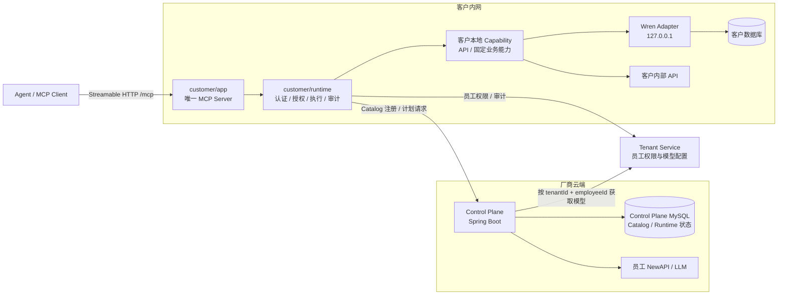
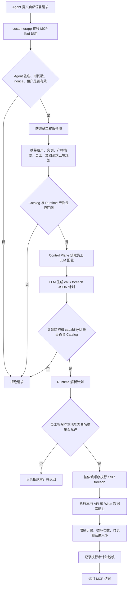
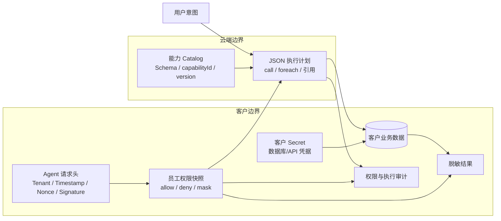
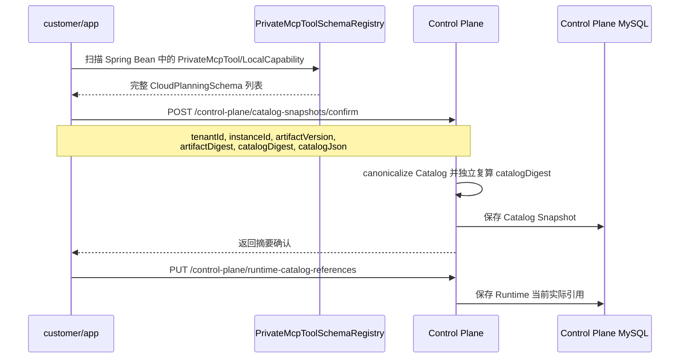
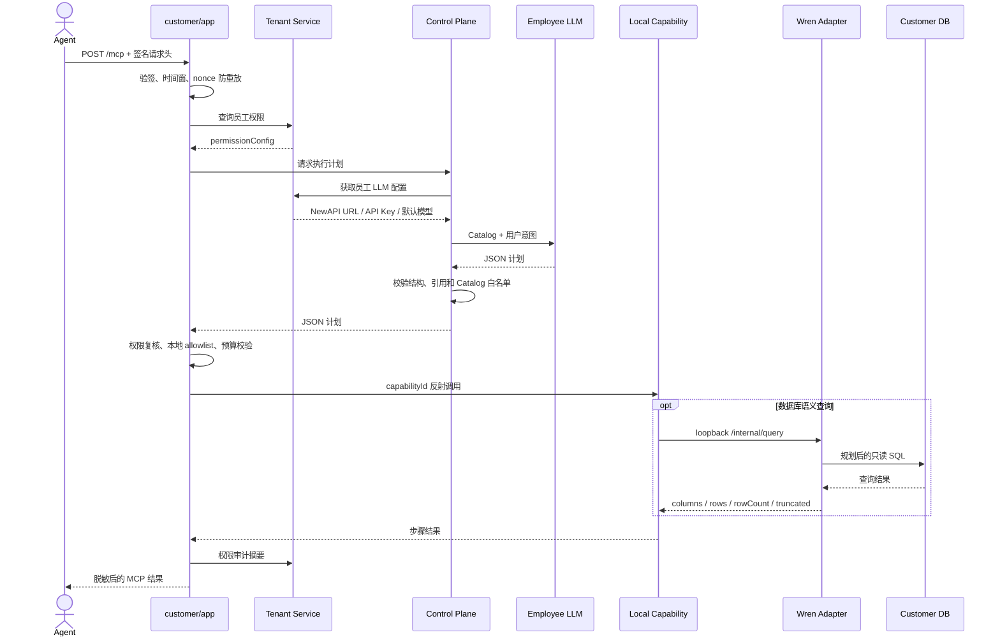
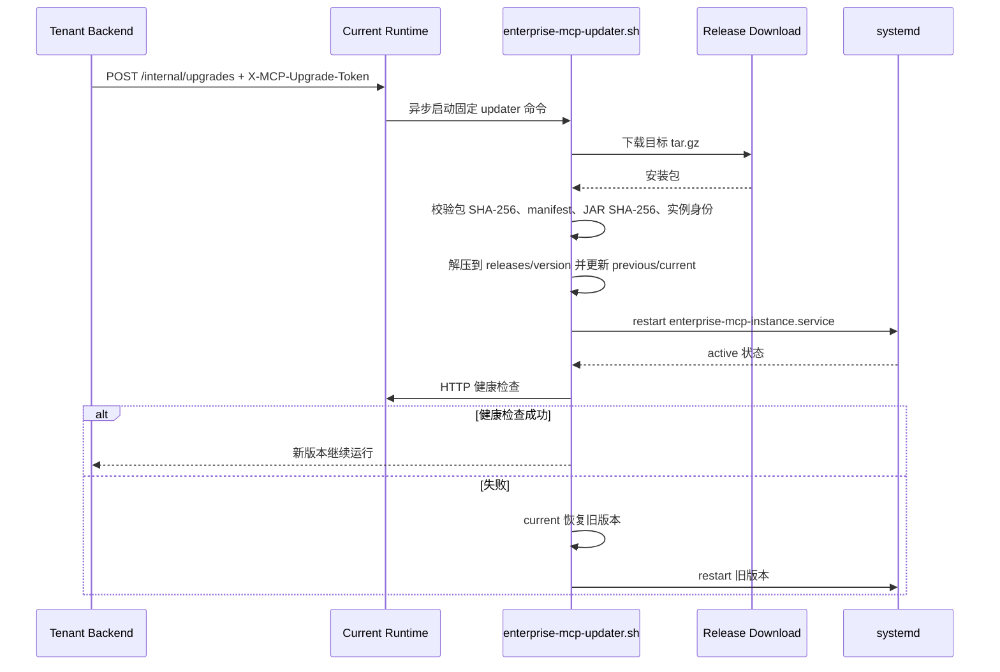

# Enterprise MCP 系统说明

本文说明 `enterprise-mcp` 当前实现的架构、数据流、运行流程、启动、部署、升级与回滚方式。本文以当前源码为准；历史设计文档只用于解释演进过程，不作为生产配置依据。

## 1. 系统定位

Enterprise MCP 是一个云端规划、客户内网执行的分层系统：

- Agent 只访问客户内网中的 `customer/app` MCP Server。
- 云端 `control-plane` 保存 Runtime 上传的能力 Catalog，并使用当前员工自己的模型生成结构化执行计划。
- 客户 Runtime 验证 Agent 身份和员工权限，按本地能力白名单执行计划，并完成结果脱敏和审计。
- Wren Adapter 是 customerapp 托管的本机数据库语义引擎，不是第二个 MCP Server，也不允许 Agent 或云端直接访问。
- 客户数据库凭据、内部 API 凭据和业务数据停留在客户边界内。

当前云端返回的是普通 JSON 执行计划，不包含 SQL、Java 类名、数据库 URL 或客户密钥。当前版本没有对计划进行数字签名，安全边界由 Runtime 身份、产物摘要、Catalog 绑定、本地能力白名单、员工权限、执行预算和审计共同构成。

## 2. 代码与部署单元

| 模块 | 部署位置 | 是否独立运行 | 主要职责 |
|---|---|---:|---|
| `shared/contract` | 两侧依赖 | 否 | 注解、Catalog Schema、执行计划 DTO 等稳定契约 |
| `cloud/control-plane` | 厂商云端 | 是 | Catalog/Runtime 注册持久化、员工模型配置获取、LLM 规划、计划校验 |
| `customer/runtime` | 打入客户 JAR | 否 | Agent 验签、权限、本地执行器、预算、脱敏、审计、升级入口 |
| `customer/app` | 客户内网 | 是 | 唯一 MCP Server、客户定制能力、内部 API Adapter、Wren 代理 |
| `customer/wren` | 客户内网本机 | 可选 Sidecar | MDL、SQL 规划、目标数据库连接与查询执行 |

最终主要产物：

```text
cloud/control-plane/target/enterprise-mcp-control-plane-0.0.1-SNAPSHOT.jar
customer/app/target/customer-enterprise-mcp-1.0.0.jar
```

客户 Java 服务只部署一个 Fat JAR。启用 Wren 时，还需为每个客户实例部署一个仅监听 loopback 的 Python Adapter 进程。

## 3. 总体架构图



固定调用方向：

```text
Agent -> customerapp -> Control Plane -> 员工模型
                    -> 本地 Capability -> Wren -> 客户数据库
                    -> 本地 Capability -> 客户内部 API
```

禁止的调用方向：

```text
Agent -X-> Wren
Control Plane -X-> Wren
Control Plane -X-> 客户数据库或内部 API
Wren -X-> MCP 协议入口
```

## 4. 核心流程图



执行计划当前支持：

- `call`：调用一个已注册的 `capabilityId + capabilityVersion`。
- `foreach`：遍历前序步骤的集合结果并执行循环体。
- `dependsOn`：声明步骤依赖。
- `saveAs`、`fromStep`、`fromItem`：保存和引用执行结果。
- 全局最大步骤数、循环次数、执行时长和结果字节数限制。

### 4.1 Wren 语义澄清

当 Wren 发现多个 Current MDL 字段都可能改变查询含义时，Adapter 返回绑定 `sourceKey + mdlDigest` 的
`NEEDS_CLARIFICATION`，并且候选只能是 Current MDL 中真实存在的 `Model.column`。Runtime 通过 MCP
Elicitation 向用户展示 2 至 5 个候选项；用户接受后，Runtime 记录不含自由文本原文的澄清审计，把确认
内容加入原始意图，并重新生成和校验整份只读计划，不从旧计划的中间步骤继续。

单次请求最多澄清 3 轮。用户拒绝或取消、Agent 未协商 Elicitation、等待超过
`ENTERPRISE_MCP_ELICITATION_TIMEOUT`、候选不合法，或者等待期间 Current MDL 摘要发生变化时，本次查询
直接终止，不执行猜测结果。当前项目 Agent 已确认支持 MCP Elicitation；真实 Agent 到 customerapp 的能力
协商、接受、取消与超时链路仍需在部署环境完成端到端验收。

## 5. 数据流图



数据归属原则：

| 数据 | 所有者/事实来源 | 是否进入云端 |
|---|---|---:|
| Runtime 身份、版本、摘要 | Platform 发布 + Runtime 实际上报 | 是 |
| Capability Catalog Schema | Runtime 启动扫描结果 | 是 |
| 用户意图、员工 ID | 当前请求 | 是，用于规划 |
| 员工 LLM API Key | Tenant/NewAPI 配置 | 仅 Control Plane 请求期使用，不进计划和日志 |
| 数据库/API 凭据 | 客户 Secret Provider/Wren profile 占位符 | 否 |
| 客户数据库原始数据 | 客户数据库 | 不应由 Control Plane 直接读取 |
| 权限配置和执行审计 | Tenant 与客户 Runtime | 按审计接口上报必要摘要 |

## 6. 时序图

### 6.1 Runtime 启动与 Catalog 注册



Runtime 同步失败时进程仍可启动，但规划保持 `NOT_READY`；后台任务会自动重试确认和引用，不提供人工“同步 Catalog”按钮。

### 6.2 一次 MCP 查询



`database.semantic-query` 在每次调用中携带必填 `sourceKey` 和员工请求级 LLM 配置。Adapter 只从 Current MDL 中读取该数据源的 MDL 与连接，一次调用只生成并执行一条属于该数据源的只读 SQL。真实 Tenant 员工模型和客户数据库的端到端链路仍需在部署环境验证。

### 6.3 升级与失败回滚



## 7. Wren 与多数据源

Wren 当前支持多种数据库/文件数据源类型，包括 MySQL、PostgreSQL、SQL Server、Oracle、ClickHouse、Doris、Snowflake、BigQuery、Trino、Databricks、Redshift、Athena、Spark、DuckDB、本地文件、S3、MinIO 和 GCS。HTTP/行政系统/钉钉等 API 不配置为 Wren profile，而是在 customerapp 中实现独立的 `@PrivateMcpTool` Capability，再由云端计划和本地执行器与数据库能力组合。

能力边界：

| 能力 | 当前状态 |
|---|---|
| 一个客户配置多个命名 profile | 支持 |
| 不同 profile 使用不同数据库类型 | 支持 |
| 每客户独立 Wren 实例目录 | 支持 |
| 单次查询选择指定 profile | 支持；`database.semantic-query` 必须传入 Current MDL 中存在的 `sourceKey` |
| 多个计划步骤分别访问不同数据源 | 支持；每一步使用各自的 `sourceKey`，结果由 Runtime 后续步骤传递 |
| 一条 SQL 跨多个数据库联邦 Join | 明确禁止；一条 SQL 只能访问一个 `sourceKey` 对应的数据源 |

生产映射固定为“一个 Wren project 对应一个明确数据源/业务语义域”。跨源请求由云端计划生成多个 `database.semantic-query` 步骤，客户 Runtime 在明确的数据量预算内传递结构化结果；Adapter 不允许在一条 SQL 内隐式切换或联合多个数据源。

管理员点击“应用更新”后，customerapp 先让 Wren 固化并校验候选 MDL，再将完整候选 Catalog 交给 Control Plane 独立复算和确认。只有确认成功才原子替换本地 Current MDL；云端不可用、摘要不一致或校验失败时，旧 Current MDL 保持不变。提交后若 Runtime 当前引用暂时保存失败，规划进入 `NOT_READY` 并由后台任务自动恢复，不允许继续使用旧计划。

## 8. 环境要求

### 8.1 通用构建环境

- JDK 21
- Maven 3.9 或兼容版本
- Spring Boot 4.1.0
- Spring AI 2.0.0

### 8.2 Control Plane

- MySQL 8.x 或兼容实例
- 可访问 Tenant 内部员工模型配置接口
- 可访问员工 NewAPI/LLM 地址
- 生产服务间认证、TLS、备份和监控由部署环境提供

### 8.3 Customer Runtime

- JDK 21
- 可访问 Control Plane、Tenant 服务和客户内部系统
- Agent RSA 公钥及其 SHA-256 指纹
- 在当前租户内稳定且唯一的 `instance-id`
- Runtime 自动计算实际部署 JAR 的 `artifact-digest`；部署方可选提供期望摘要用于一致性校验

### 8.4 Wren（启用时）

- Python 3.11+，当前开发环境使用 Python 3.12
- `customer/wren/adapter/requirements.txt` 中的依赖
- 对应数据源的可选驱动，例如 MySQL、PostgreSQL 或 SQL Server 驱动
- 每客户独立的 `WREN_PROJECT_ROOT` 和 `WREN_INSTANCE_DIR`

Wren Python 端不需要与 Spring AI MCP 使用相同 SDK。生产路径是内部 HTTP RPC，不是 MCP 协议。

## 9. 构建方式

在仓库根目录执行：

```bash
mvn clean package
```

只构建客户 Runtime：

```bash
mvn -pl customer/app -am clean package
```

只构建 Control Plane：

```bash
mvn -pl cloud/control-plane -am clean package
```

Wren Adapter 静态检查与测试：

```powershell
$env:PYTHONPATH = "$PWD\customer\wren\upstream\src;$PWD\customer\wren\adapter"
.\.venv-wrenai\Scripts\python.exe -m unittest customer/wren/adapter/test_server.py
```

## 10. 本地启动方式

### 10.1 启动 Control Plane

PowerShell 示例：

```powershell
$env:ENTERPRISE_MCP_CONTROL_PLANE_PORT = "7001"
$env:ENTERPRISE_MCP_DB_URL = "jdbc:mysql://127.0.0.1:3306/saas_mcp?useUnicode=true&characterEncoding=UTF-8&serverTimezone=Asia/Shanghai"
$env:ENTERPRISE_MCP_DB_USERNAME = "enterprise_mcp"
$env:ENTERPRISE_MCP_DB_PASSWORD = "<secret>"
$env:ENTERPRISE_MCP_CONTROL_TENANT_SERVICE_BASE_URL = "http://127.0.0.1:8002"
java -jar cloud/control-plane/target/enterprise-mcp-control-plane-0.0.1-SNAPSHOT.jar
```

启动时 Flyway 自动升级 Control Plane 自有表。生产环境禁止使用仓库中的默认 MySQL 密码。

### 10.2 安装并启动 Wren Adapter（可选）

生产 Linux 一键安装：

```bash
sudo bash customer/wren/installer/install-wren-linux.sh
```

生产 Windows 一键安装（管理员 PowerShell）：

```powershell
Set-ExecutionPolicy -Scope Process Bypass
& .\customer\wren\installer\install-wren-windows.ps1
```

两端默认进入交互向导：使用 `↑/↓` 移动选项，使用空格键多选数据源驱动，使用回车键确认。向导会显示最终配置摘要，并允许安装、返回修改或取消。参数模式仅用于 CI/无人值守安装。

开发环境仍可直接启动：

```bash
customer/wren/launcher/run-adapter.sh \
  /opt/enterprise-mcp/tenant-10000-mcp-20001/wren/data \
  8091 \
  /var/lib/enterprise-mcp/tenant-10000-mcp-20001/wren
```

健康检查：

```bash
curl http://127.0.0.1:8091/internal/health
```

安装器会创建独立虚拟环境和实例级持久化目录，并分别注册 Linux systemd 服务或 Windows SYSTEM 开机计划任务。Adapter 必须绑定 `127.0.0.1`。数据库密码应在 profile 中使用 `${ENV_NAME}` 占位符，通过安装器的环境文件注入。

完整参数见 [Wren 一键安装部署说明](../customer/wren/installer/安装部署说明.md)。

### 10.3 启动 Customer Runtime

PowerShell 示例：

```powershell
$env:ENTERPRISE_MCP_PORT = "6001"
$env:SAAS_TENANT_ID = "10000"
$env:ENTERPRISE_MCP_INSTANCE_ID = "tenant-10000-mcp-20001"
$env:ENTERPRISE_MCP_ARTIFACT_VERSION = "1.0.0"
# packaged Fat JAR 模式会自动计算实际运行 JAR；此变量仅用于可选的一致性校验。
# target/classes 或 IDE 模式会自动汇总 classpath 中的编译输出目录。
$env:ENTERPRISE_MCP_ARTIFACT_DIGEST = "sha256:<optional-expected-jar-sha256>"
$env:ENTERPRISE_MCP_PLANNING_URL = "http://127.0.0.1:7001/control-plane/planning/plans"
$env:TENANT_SERVER_URL = "http://127.0.0.1:8002"
$env:SAAS_AGENT_PUBLIC_KEY_PEM = "<base64-public-key>"
$env:SAAS_AGENT_PUBLIC_KEY_FINGERPRINT = "<sha256-fingerprint>"
$env:ENTERPRISE_MCP_WREN_ENABLED = "true"
$env:ENTERPRISE_MCP_WREN_PROJECT_ROOT = "D:\customer\wren"
$env:ENTERPRISE_MCP_WREN_INSTANCE_DIR = "D:\customer\wren\instances\tenant-10000-mcp-20001"
java -jar customer/app/target/customer-enterprise-mcp-1.0.0.jar
```

MCP 地址：

```text
http://<customer-host>:6001/mcp
```

启动顺序建议：

```text
MySQL -> Tenant/NewAPI -> Control Plane -> Wren Adapter（启用时） -> Customer Runtime -> Agent
```

## 11. 生产部署方式

### 11.1 Control Plane 部署

Control Plane 是普通 Spring Boot 服务，可使用 systemd、容器或 Kubernetes 部署。生产至少需要：

1. 将 MySQL 地址和凭据放入 Secret 管理系统。
2. 配置 Tenant 内部地址和网络认证。
3. 仅向客户 Runtime 开放 `/control-plane/catalog-snapshots/confirm`、`/control-plane/runtime-catalog-references` 和 `/control-plane/planning/plans` 所需网络路径。
4. 为 MySQL 执行备份、恢复演练和多实例并发验证。
5. 对 Runtime 注册失败、规划失败、Tenant/LLM 超时建立指标和告警。

### 11.2 Customer Runtime 首次安装

仓库提供 Linux bootstrap，目录布局如下：

```text
/opt/enterprise-mcp/<instance-id>/
  releases/<version>/
  current -> releases/<version>/
  previous -> releases/<version>/
/etc/enterprise-mcp/<instance-id>/application.yml
/var/lib/enterprise-mcp/<instance-id>/
```

前置依赖：Java 21、`jq`、`sha256sum`、`tar`、`curl`、`systemctl`。

安装命令：

```bash
sudo ./deploy/enterprise-mcp-bootstrap.sh \
  --instance-id tenant-10000-mcp-20001 \
  --platform-mcp-id 20001 \
  --tenant-id 10000 \
  --package /tmp/enterprise-mcp-1.0.0.tar.gz \
  --config /tmp/application.yml \
  --sha256 <package-sha256>
```

安装包根目录必须包含：

```text
manifest.json
customer-enterprise-mcp-<version>.jar
```

`manifest.json` 至少包含 `platformMcpId`、`instanceId`、`version`、`jarName`、`artifactSha256` 和 HTTP 健康检查配置。bootstrap 校验包和 JAR 摘要、身份与版本后，创建独立 systemd 服务。

当前 customerapp 源码没有专用的应用健康 Controller；`deploy/manifest.example.json` 中的 `/` 只是打包示例。启用自动升级前，必须由 customerapp 或部署层提供一个无需业务凭据且成功时稳定返回 HTTP 200 的健康端点，并把真实路径写入 manifest。否则 updater 会按设计判定新版本不健康并自动回滚。

### 11.3 Wren 生产部署

Wren 使用独立安装器部署，不并入 Customer Runtime Fat JAR：

- Linux：`customer/wren/installer/install-wren-linux.sh` 创建虚拟环境、持久化目录和 `enterprise-wren-<instance-id>.service`。
- Windows：`customer/wren/installer/install-wren-windows.ps1` 创建虚拟环境、持久化目录和 `EnterpriseMcp-Wren-<instance-id>` 开机计划任务。
- 两端默认通过交互向导选择数据源驱动、`wren.env` 和 `profiles.yml`，同时保留 `--extras`/`-Extras` 等参数供自动化安装；更新 runtime 后会执行健康检查和失败回退。
- 客户 MDL、profile、环境文件位于实例状态/配置目录，重复安装不会默认覆盖。

Wren 与 customerapp 是两个独立进程，Wren 安装成功后 customerapp 的 `ENTERPRISE_MCP_WREN_EXECUTABLE` 应保持为空，只通过 `ENTERPRISE_MCP_WREN_BASE_URL` 连接现有 Adapter。Customer Runtime 的 JAR updater 不会自动升级 Wren；升级 Wren 时重新运行对应 Wren 安装器。

## 12. 升级与回滚方式

### 12.1 Tenant 触发在线升级

Runtime 管理入口：

```http
POST /internal/upgrades
X-MCP-Upgrade-Token: <ENTERPRISE_MCP_UPGRADE_TOKEN>
Content-Type: application/json

{
  "downloadUrl": "https://platform.example.com/public/tenant-mcp-release/download/123",
  "version": "1.1.0",
  "sha256": "<package-sha256>"
}
```

Runtime 仅能启动配置中的固定 updater：

```text
ENTERPRISE_MCP_UPDATER_COMMAND=/usr/local/libexec/enterprise-mcp-updater.sh
```

请求方不能传入任意 shell 命令。接口校验共享 token 后返回 HTTP `202 Accepted`，实际升级由 updater 异步完成。

### 12.2 运维手工升级

```bash
sudo ./deploy/enterprise-mcp-updater.sh \
  --instance-id tenant-10000-mcp-20001 \
  --package /tmp/enterprise-mcp-1.1.0.tar.gz \
  --sha256 <package-sha256>
```

也可以由 updater 直接下载：

```bash
sudo ./deploy/enterprise-mcp-updater.sh \
  --instance-id tenant-10000-mcp-20001 \
  --download-url https://platform.example.com/release.tar.gz \
  --version 1.1.0 \
  --sha256 <package-sha256>
```

### 12.3 回滚

回滚到已安装版本：

```bash
sudo ./deploy/enterprise-mcp-updater.sh \
  --instance-id tenant-10000-mcp-20001 \
  --version 1.0.0
```

升级器在切换前保存 `previous`。新版本启动后必须同时满足：

- systemd service 为 active；
- manifest 声明的 HTTP 健康检查返回期望状态码。

任何一项失败都会将 `current` 恢复到原版本并重启。外置配置与运行状态位于 `/etc` 和 `/var/lib`，不会被版本目录覆盖。

## 13. 关键配置清单

### 13.1 Control Plane

| 环境变量 | 必需 | 说明 |
|---|---:|---|
| `ENTERPRISE_MCP_CONTROL_PLANE_PORT` | 否 | 默认 `7001` |
| `ENTERPRISE_MCP_DB_URL` | 是 | Catalog/Runtime 状态 MySQL |
| `ENTERPRISE_MCP_DB_USERNAME` | 是 | MySQL 用户 |
| `ENTERPRISE_MCP_DB_PASSWORD` | 是 | 必须由 Secret 注入 |
| `ENTERPRISE_MCP_CONTROL_TENANT_SERVICE_BASE_URL` | 是 | Tenant 内部服务地址 |
| `ENTERPRISE_MCP_CONTROL_EMPLOYEE_LLM_CONFIG_CACHE_TTL` | 否 | 员工模型配置硬过期时间 |
| `ENTERPRISE_MCP_CONTROL_LLM_READ_TIMEOUT` | 否 | LLM 规划读取超时 |
| `ENTERPRISE_MCP_CONTROL_CATALOG_RETENTION_GRACE` | 否 | 未被 Runtime 引用的 Catalog Snapshot 最短保留时间，默认 10 分钟 |
| `ENTERPRISE_MCP_CONTROL_CATALOG_CLEANUP_DELAY` | 否 | Catalog 清理任务间隔，默认 1 小时 |

### 13.2 Customer Runtime

| 环境变量 | 必需 | 说明 |
|---|---:|---|
| `SAAS_TENANT_ID` | 是 | 租户唯一编号 |
| `ENTERPRISE_MCP_INSTANCE_ID` | 是 | 当前租户内唯一的 Runtime 实例编号 |
| `ENTERPRISE_MCP_ARTIFACT_VERSION` | 是 | 实际 JAR 版本 |
| `ENTERPRISE_MCP_ARTIFACT_DIGEST` | 否 | Runtime 自动计算 Fat JAR 或 IDE classpath 编译输出；若提供则必须匹配 `sha256:<64 位小写十六进制>` |
| `ENTERPRISE_MCP_PLANNING_URL` | 是 | 必须以 `/control-plane/planning/plans` 结尾 |
| `TENANT_SERVER_URL` | 是 | 员工权限与审计服务 |
| `SAAS_AGENT_PUBLIC_KEY_PEM` | 是 | 当前客户 Agent 公钥 |
| `SAAS_AGENT_PUBLIC_KEY_FINGERPRINT` | 是 | 必须与公钥匹配 |
| `ENTERPRISE_MCP_UPGRADE_TOKEN` | 在线升级时 | Tenant 调用升级接口的共享 Secret |
| `ENTERPRISE_MCP_ELICITATION_TIMEOUT` | 否 | Wren 语义澄清等待用户回答的 MCP 超时，默认 5 分钟 |
| `ENTERPRISE_MCP_WREN_ENABLED` | 启用 Wren 时 | 是否启用 Wren |
| `ENTERPRISE_MCP_WREN_PROJECT_ROOT` | 启用 Wren 时 | 当前客户 Modeling、Current MDL 与短生命周期候选目录的项目根目录 |
| `ENTERPRISE_MCP_WREN_INSTANCE_DIR` | 启用 Wren 时 | 当前客户独立 profile/状态目录 |

## 14. 安全与失败策略

- Agent 请求必须通过租户公钥验签、时间窗和 nonce 防重放检查。
- Runtime 启动时校验公钥与指纹，不允许静默接受错配配置。
- Control Plane 只允许计划引用当前 Catalog 中的 `capabilityId` 和版本。
- Runtime 再次按本地注册表和员工 `allowCapabilities` 执行硬授权。
- 云端不可用、Catalog 未注册、员工模型配置过期且刷新失败时，规划失败关闭，不在本地用未知计划兜底。
- Wren 默认只应执行受 MDL 和只读策略约束的查询；行数、请求体、超时和结果大小必须有限制。
- `/internal/wren/**` 当前是 customerapp 管理代理路径，生产环境必须通过反向代理、管理网或 Spring Security 限制为管理员调用，不能向 Agent 或公网开放。
- Control Plane 当前没有内建完整的服务间认证，生产必须在网关或服务层增加 mTLS/服务凭据和租户归属校验。
- 数据库密码、API Token、LLM API Key 不得进入 Catalog、执行计划、日志或代码仓库。
- 升级必须同时校验安装包 SHA-256 和 manifest 中的 JAR SHA-256。

## 15. 运维检查与故障定位

| 现象 | 首要检查 |
|---|---|
| Runtime 能启动但所有规划失败 | 查 `Runtime registration submitted`；核对 `artifactDigest` 和 Planning URL |
| 注册返回 HTTP 400 | 核对 tenantId、instanceId、artifactVersion、artifactDigest、catalogJson 是否非空 |
| Agent 请求 Unauthorized | 核对 Tenant/Timestamp/Nonce/Authorization、公钥指纹、时间偏差和 nonce 重放 |
| Control Plane 无法规划 | 核对 Tenant 员工模型接口、员工 API Key、模型列表和 LLM 超时 |
| Wren health 正常但查询失败 | 核对项目 pinned profile、`WREN_INSTANCE_DIR`、数据库驱动、MDL 和数据库权限 |
| 升级自动回滚 | 查 systemd 日志、manifest 健康路径、端口、包/JAR SHA-256 和实例身份 |

常用命令：

```bash
systemctl status enterprise-mcp-<instance-id>
journalctl -u enterprise-mcp-<instance-id> -n 200 --no-pager
curl -i http://127.0.0.1:6001/internal/health
curl http://127.0.0.1:8091/internal/health
sha256sum customer-enterprise-mcp-1.0.0.jar
```

## 16. 当前验证边界

仓库内可以验证：Maven 构建和单元测试、Catalog 生成与注册契约、计划解析和执行器、权限/预算逻辑、Wren Adapter 单元测试与本机 HTTP 冒烟、部署脚本语法。

仍必须在真实环境验证：

- 客户 MySQL、SQL Server 等数据库的网络、TLS、最小权限、字符集、时区和数据量。
- 客户 Wren MDL、profile、目标方言和慢查询策略。
- Tenant 的真实员工权限及员工 LLM/Embedding 模型配置接口。
- 真实 LLM 生成计划以及请求级模型配置注入 Wren 的完整链路。
- 客户内部 API 的证书、认证、幂等、限流和部分失败处置。
- Linux systemd 首次安装、远程升级、健康失败自动回滚和旧版本恢复。
- Wren 安装器已通过脚本语法和静态契约检查；Linux systemd、Windows SYSTEM 计划任务、数据库驱动安装及失败回退仍需在对应真实操作系统演练。
- Customer Runtime 专用 HTTP 健康端点尚未实现；这是启用自动升级前的代码/部署前置项，不是已经完成的真实环境验证项。
- Control Plane 多实例、MySQL 备份恢复、服务间认证、生产网络和告警。
- 单条 SQL 跨多个数据库的数据联邦能力当前未实现，不属于环境验证项。

## 17. 关联文档

- [Linux 部署工具说明](../deploy/README.md)
- [私有部署能力设计](部署运维/私有部署能力设计.md)
- [模块开发与打包指南](模块开发与打包指南.md)
- [环境验证矩阵](环境验证矩阵.md)
- [WrenAI 集成评估](调研评估/WrenAI集成评估.md)
- [Wren Runtime 说明](../customer/wren/README.md)

## 18. 能力核销表

| 模型要素 | 当前行为 | 使用或运维入口 | 当前证据/边界 |
|---|---|---|---|
| MCP 请求 | Agent 调用唯一客户 MCP Server | `POST /mcp` | Spring AI MCP 2.0 配置；真实 Agent 联调待环境 |
| Runtime Catalog | 启动确认完整 Catalog Snapshot 并保存当前引用 | `/control-plane/catalog-snapshots/confirm`、`/control-plane/runtime-catalog-references` | RuntimeCatalog 与 MySQL Repository 已实现 |
| 云端规划 | 使用员工模型生成并校验 JSON 计划 | `/control-plane/planning/plans` | 结构/Catalog 校验已有测试；真实模型待验证 |
| 本地执行 | 执行 `call`、`foreach`、依赖和结果引用 | `CommonInternalTool` / `JsonPlanExecutor` | 单元测试和预算限制 |
| 员工权限 | 本地 allowlist、拒绝规则、脱敏和审计 | Tenant 员工权限/审计接口 | 模拟与单元验证；真实权限待验证 |
| Wren 查询 | 本机 MDL、SQL 规划和数据库连接 | customerapp -> `127.0.0.1:8091` | Adapter 冒烟已通过；请求级员工模型尚未接通 |
| Wren 安装 | 创建独立 runtime/venv、注册 OS 启动项、健康失败回退 | `customer/wren/installer/` | Bash/PowerShell 语法通过；真实 systemd/计划任务待验证 |
| 多数据源 | 支持多种连接器和多个 profile | Wren 数据源管理 API | 单源绑定可用；跨库联邦 SQL 未实现 |
| 首次安装 | 校验 manifest/JAR 并创建 systemd 服务 | `enterprise-mcp-bootstrap.sh` | 脚本实现；真实 Linux 待演练 |
| 升级/回滚 | 原子切换、systemd 重启、HTTP 探测、失败回滚 | `/internal/upgrades` / updater | 缺少专用应用健康端点，尚不能宣称完整可用 |
